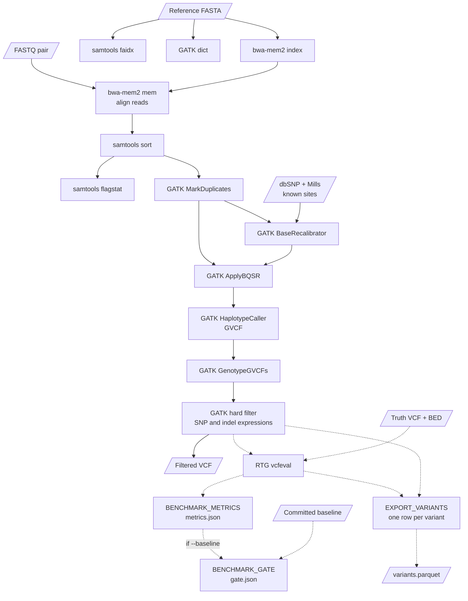
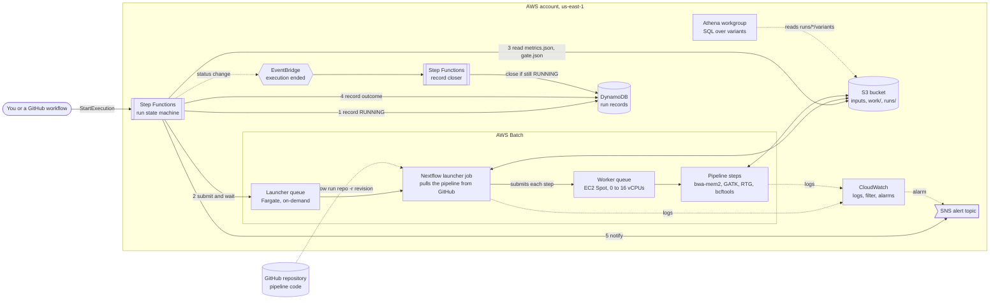
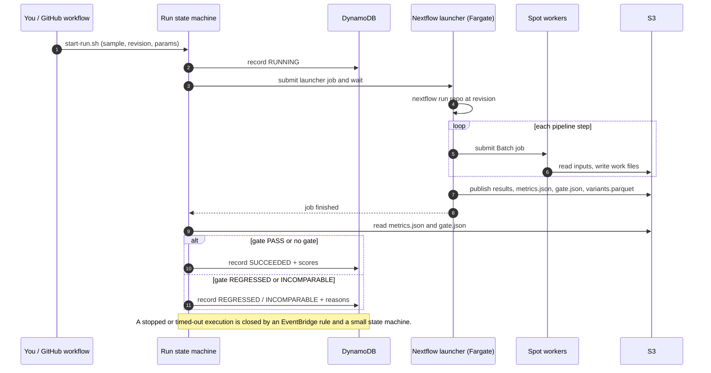

# nextflow-giab

A germline short-variant pipeline (SNVs and small indels) in Nextflow DSL2, with the AWS infrastructure to run it defined in CDK (TypeScript), and a benchmark that scores every run against a published answer key. It is a research-grade demo built with clinical-lab habits: pinned tools, full provenance for every run, and a regression gate that fails a change that makes results worse. It handles public data only and is not a clinical pipeline (see [What this is not](#what-this-is-not)).

- **Live results:** https://jameswagner.github.io/nextflow-giab/ (benchmark history, rebuilt after each merge).
- **Accuracy:** on GIAB HG002, chr20 at about 30x, SNP F1 0.990 and indel F1 0.936. A deliberately broken SNP filter drops SNP F1 to 0.533 and the gate fails it.
- **Cost and speed:** about 57 minutes and about 30 cents per run, on Spot machines that scale to zero.
- **No stored cloud keys:** GitHub Actions reach AWS through OIDC roles, each trusted for one environment of this repository.

## How it fits together

The variant-calling pipeline (`main.nf`). Dashed steps run only when a truth set is given:



The AWS side. A Step Functions state machine owns each run's lifecycle, Nextflow runs inside a Fargate job, and its steps run on Spot workers:



A run, start to finish:



**Inputs** are a samplesheet CSV (`sample_id,fastq_1,fastq_2`) plus a GRCh38 reference and dbSNP and Mills known-sites VCFs. **Outputs** are a filtered VCF and MarkDuplicates metrics, and, if a truth set is given, a vcfeval score, a metrics record, an optional gate result and a table of every variant.

## What each step does

Each step is a Nextflow process in `modules/`, run in its own pinned container. Everything is keyed on the sample ID, never on the order files arrive in.

**Reference prep.** Three small steps prepare the reference genome once, and every sample shares the results. `SAMTOOLS_FAIDX` writes a `.fai` index so tools can jump to any position in the FASTA without reading the whole file. `GATK_DICT` writes the sequence dictionary (contig names and lengths) that GATK requires beside the reference. `BWAMEM2_INDEX` builds the alignment index that bwa-mem2 searches, which is the slow part of reference prep.

**`BWAMEM2_MEM`: align the reads.** Takes the sample's two FASTQ files (the paired reads from the sequencer) and finds where each read best matches the reference, writing a SAM file (text alignments). It stamps every read with a read group (sample name, Illumina platform), which GATK needs later to know which reads belong together.

**`SAMTOOLS_SORT`: sort and index.** Alignments come out in the order the reads were processed. This step sorts them by genomic position, writes a compressed BAM, and indexes it so later tools can fetch any region quickly.

**`SAMTOOLS_FLAGSTAT`: count the alignments.** A quick quality check on the sorted BAM: how many reads there are, how many aligned, how many paired properly. The numbers go to the task log, and a sudden drop in the aligned fraction is the first sign of a bad input or reference.

**`GATK_MARKDUPLICATES`: flag duplicate reads.** Library preparation can copy the same DNA fragment several times, and counting those copies as independent evidence would overstate confidence in a variant. This step finds reads that look like copies of one fragment and flags them (it does not delete them), so the variant caller can ignore the extras. It also writes a metrics file with the duplicate rate.

**`GATK_BASERECALIBRATOR`: learn the sequencer's errors.** Each base in a read has a quality score from the sequencer, and those scores are systematically a little off. This step compares the reads with sites where variation is already well known (dbSNP and the Mills indel set) and builds a table of how much each kind of base call should be corrected.

**`GATK_APPLYBQSR`: apply the corrections.** Rewrites the BAM with the quality scores adjusted by that table. The variant caller trusts these scores, so better-calibrated scores mean fewer false variants and fewer missed ones.

**`GATK_HAPLOTYPECALLER`: propose variants.** Looks for places where the reads disagree with the reference. It re-assembles the reads in each active region into candidate haplotypes and scores them, rather than just counting mismatches, which handles small insertions and deletions well. It runs in GVCF mode, which records evidence for every position, not just the variable ones.

**`GATK_GENOTYPEGVCFS`: decide the genotypes.** Turns that evidence into a VCF (the variant list) by deciding, at each variable site, whether the person has one copy of the change or two. With one sample this is nearly a formality; the GVCF-then-genotype split exists so that several samples could be genotyped together, which this pipeline does not do yet.

**`GATK_HARDFILTER`: drop weak calls.** SNPs (single-letter changes) and indels (small insertions and deletions) behave differently, so each is split out and filtered with its own thresholds, such as depth-normalised quality (`QD`), strand bias (`FS`, `SOR`) and mapping quality (`MQ`). A call that fails is marked in the FILTER column, not deleted, and the two sets are merged back into the final VCF. The thresholds are parameters (`--snp_filter`, `--indel_filter`), validated for safe characters because they end up in a shell command.

**`RTG_FORMAT`: prepare the reference for scoring.** Converts the reference FASTA into the SDF format that RTG Tools reads. This runs only when a truth set is given.

**`RTG_VCFEVAL`: score against the answer key.** Compares the filtered calls with GIAB's truth set for HG002, but only inside the regions GIAB considers high-confidence. It matches variants by the sequence they produce rather than by exact position and spelling, so the same indel written two ways still counts as correct. The result is counts of true positives, false positives and false negatives, plus precision, recall and F1. Calls that failed the filters are ignored.

**`BENCHMARK_METRICS`: write the record.** Reads vcfeval's summary and writes one JSON record in a fixed, versioned format (`schemas/benchmark-metrics.v1.schema.json`). Besides the scores it records where the run came from (pipeline commit, run type, container digests, truth set) and the parameters that can change the scores, together with a hash of them, so two runs can be compared knowing exactly what differed. The logic is in `bin/benchmark_metrics.py`, with its own tests.

**`BENCHMARK_GATE`: pass or fail the change.** Compares the record with a committed baseline (`benchmarks/hg002-chr20.json`) and writes `PASS`, `REGRESSED` (a score dropped by more than the baseline's tolerance, currently 0.002) or `INCOMPARABLE` (different sample, truth set, region or reference, so the comparison would mean nothing). Scores may rise freely, and a run can never change the baseline: updating it is a reviewed edit to that file. This runs only when `--baseline` is given.

**`EXPORT_VARIANTS`: one row per variant.** Turns vcfeval's answer into a table you can query. Every call gets a label: `tp` (matches the truth set), `fp` (not in it), `fn` (a truth variant the calls missed, with only its position and alleles known), or `outside` (a PASS call outside the scored regions, which vcfeval ignores). Each row carries the GATK annotations the filters use, so a question like "what would a stricter QD cutoff remove?" is a query. A sample with no truth set, which is every new sample, gets the same table with every PASS call labelled `called` (`EXPORT_CALLED_VARIANTS`), so its variants are queryable too.

**`CONVERT_VARIANTS_PARQUET`: the table as Parquet.** Rewrites that table with typed columns and real nulls (a missed variant has no quality score, which is a null and not the text "\\N"), and publishes it at `runs/<run id>/variants/`, where Athena reads it.

## Run on AWS Batch

```bash
cd infra && npm install
npx cdk bootstrap --qualifier giab --toolkit-stack-name CDKToolkit-giab   # once per account and region; matches infra/cdk.json
npx cdk deploy                     # add -c alertEmail=<address> for alarm emails

# Stack outputs: BucketName, JobQueueName, JobRoleArn
export JAVA_HOME=/opt/homebrew/opt/openjdk@21
export GIAB_BATCH_QUEUE=<JobQueueName> GIAB_JOB_ROLE=<JobRoleArn>

nextflow run main.nf -profile awsbatch \
  -work-dir s3://<BucketName>/work -output-dir s3://<BucketName>/results \
  --samplesheet <samplesheet.csv> --fasta s3://.../genome.fasta \
  --dbsnp ... --dbsnp_tbi ... --mills ... --mills_tbi ...
```

### Or start it from the CLI, with Nextflow running on AWS too

`scripts/run-on-aws.sh` submits a Batch (Fargate) job that runs Nextflow itself, so your machine is not involved once it is submitted:

```bash
scripts/run-on-aws.sh -n my-run -p awsbatch -- --samplesheet s3://<BucketName>/samplesheet.csv --fasta s3://... --dbsnp ...
```

Inputs must be S3 paths. `-r` picks the branch or tag of this repo to run, and the log goes to the `/giab/batch-jobs` log group.

### Recorded runs

`scripts/start-run.sh` starts the same thing through a Step Functions state machine that also keeps a run record in DynamoDB: it records the run as `RUNNING`, runs the launcher job and waits, reads the benchmark metrics if the run had a truth set, records `SUCCEEDED` or `FAILED` with the headline scores, and publishes to the alert topic. Results go to `s3://<BucketName>/runs/<run id>/`.

```bash
scripts/start-run.sh -s HG002 -r main -p awsbatch,chr20 -- --samplesheet s3://... --truth_vcf s3://... ...
```

### From GitHub

GitHub Actions reach AWS through OIDC roles (no stored keys), each trusted only for one GitHub environment of this repository:

- **Benchmark a pull request** (`benchmark-pr.yml`, started by hand with the PR number): runs the PR's head commit through the HG002 chr20 benchmark and posts the scores and gate result on the PR. Pull requests from forks are refused.
- **Benchmark (main)**: records an official benchmark for each pipeline change merged to `main`.
- **Deploy infrastructure**: deploys `InfraStack` when `infra/` changes on `main`, after a person approves it in the `production` environment.

- **Publish benchmark history**: after each `main` benchmark, rebuilds the public dashboard (`site/`, on GitHub Pages) from the run records through a read-only role. `scripts/export_history.py` publishes only an allow-list of fields and refuses anything that looks like an AWS identifier.

The roles live in a separate `GithubIdentityStack`, deployed by hand, so a workflow can never change its own permissions. `scripts/run-benchmark.sh` runs the same benchmark from a terminal (`-r <revision> -w`), or reports on a past run (`-R <run id>`).

Nothing account-specific is committed; the queue, role and bucket come from the stack outputs. `smoke/faidx.nf` is a one-step Batch smoke test, and `smoke/fail.nf` fails on purpose to check the alarms. `cdk destroy` removes everything, including the bucket contents.

## Validation: GIAB HG002, HG003 and HG004, chr20

Scored with RTG `vcfeval` against the GIAB v4.2.1 truth set for HG002 (GRCh38), inside its high-confidence regions. The reads are chr20 only, downsampled to about 30x from GIAB's 2x250 Illumina data, and the whole run took 57 minutes on Batch.

| | Precision | Recall | F1 |
|---|---|---|---|
| SNPs | 0.994 | 0.986 | 0.990 |
| Indels and other non-SNPs | 0.967 | 0.907 | 0.936 |
| All | 0.990 | 0.975 | 0.983 |

The same recipe on HG002's parents, HG003 (father) and HG004 (mother), scores within a thousandth of HG002 on every measure. These runs have no committed baseline, so the gate does not run on them:

| Sample | SNP precision / recall / F1 | Non-SNP precision / recall / F1 | All F1 |
|---|---|---|---|
| HG002 (son) | 0.994 / 0.986 / 0.990 | 0.967 / 0.907 / 0.936 | 0.983 |
| HG003 (father) | 0.992 / 0.987 / 0.990 | 0.965 / 0.906 / 0.935 | 0.983 |
| HG004 (mother) | 0.993 / 0.986 / 0.990 | 0.966 / 0.906 / 0.935 | 0.983 |

Three related samples from one library design agreeing with each other shows the pipeline is consistent, not that it is accurate beyond this setting. It is still three samples and one chromosome, scored with the conservative `_noinconsistent` BED, so it is a sanity check and not a validation. The library was designed for assembly (overlapping 2x250 reads), vcfeval skipped at least one region as too complex, and about 27% of calls fall outside the high-confidence regions and are not scored. The hard filters are parameters (`--snp_filter` and `--indel_filter`, GATK filter expressions; a record is filtered if the expression is true), defaulting to the standard thresholds in `main.nf`. Changing them is an experiment: the values are recorded in the benchmark's `params` and change its `params_hash`. Only letters, digits, spaces and `. < > = ! & | ( ) + - _` are accepted, because the expressions end up in a shell command. To score a run, pass `--truth_vcf`, `--truth_vcf_tbi`, `--truth_bed` and `--eval_region` (optionally `--truth_set` as a label). vcfeval's own files land in `benchmark/<sample>.vcfeval/`, and `benchmark/<sample>.metrics.json` holds the scores plus provenance (pipeline commit, run type, containers, truth set, parameters and their hash) in the format defined by `schemas/benchmark-metrics.v1.schema.json`. The generator is `bin/benchmark_metrics.py`; its tests run with `python3 -m unittest discover -s tests`. To also check a run against expected scores, pass `--baseline benchmarks/hg002-chr20.json`: `benchmark/<sample>.gate.json` then says `PASS`, `REGRESSED` (a score fell by more than the baseline's tolerance, currently 0.002) or `INCOMPARABLE` (different sample, truth set, region or reference). Scores may rise freely, and a run never changes the baseline; updating it is a reviewed edit to that file. All container images are pinned in `conf/containers.config`.

The default test data (nf-core/test-datasets, commit `76179c1`) is a 40 kb slice of chr22 and only about 2% of its reads align, so it gives an empty VCF; it checks the plumbing, not accuracy.

### Recreating the inputs

The benchmark inputs are built from GIAB's public data by `prep/giab_sample.nf`, a small Nextflow workflow that runs on AWS through the same launcher: it slices chr20 from the sample's 2x250 Illumina BAM (reading only that chromosome from the remote file), downsamples to about 30x, converts to FASTQ, fetches the v4.2.1 truth set and writes a samplesheet. `scripts/prepare-giab-sample.sh HG003` starts it for HG002, HG003 or HG004 and publishes everything under `s3://<bucket>/results/giab-<sample>/`. The reference and the dbSNP and Mills files are shared by every sample (see `benchmarks/hg002-chr20.args`).

## Querying the variants

Athena runs SQL over every run's variant table, with nothing to keep running. The `giab` workgroup (results in the bucket, each query capped at 1 GiB scanned) and the `variants` table (Parquet at `runs/<run id>/variants/`, partitioned by `run_id`) are defined in `infra/lib/variant-analytics.ts`, together with five saved queries: outcome counts for a run (they equal the counts in its `metrics.json`), where a run misses variants, what a stricter QD cutoff would remove and cost, which calls a child has that neither parent does, and variants per megabase (which also works for a sample with no truth set). A query has to say which runs it means (`WHERE run_id = '<id>'`, or `run_id IN (...)`), because the table does not scan every run. A managed policy grants exactly what querying needs and is attached to no one.

```sql
SELECT outcome, variant_type, count(*) AS variants
FROM giab.variants
WHERE run_id = '<run id>'
GROUP BY outcome, variant_type;
```

## What this is not

This is a research demo on public data (GIAB reference samples), not a clinical pipeline, and it makes no claim of clinical or regulatory validity.

- **Scope of the validation.** One chromosome (chr20) of a few GIAB samples, scored with the conservative `_noinconsistent` BED. There is no whole-genome or exome run, no stratified breakdown by difficult regions, and no sample-level QC (contamination, sex check, coverage thresholds).
- **No interpretation.** The pipeline stops at a filtered VCF. There is no annotation, classification or reporting, which are the regulated, human parts of clinical work.
- **No patient data.** Handling it would need customer-managed encryption keys, an audit trail (CloudTrail data events, S3 access logs), private networking with no public IPs, retained and access-controlled data, per-study data roles, and a regulatory review. None of that is built. Workers currently sit in public subnets, with a security group that allows no inbound traffic, to avoid the cost of a NAT gateway.
- **What it does show.** Pinned containers (every image by digest), a provenance record for every run (pipeline commit, container digests, truth set, parameters and their hash), and a committed baseline that a change must not fall below, which is change control in miniature.

## Repository layout

| Path | What is there |
|---|---|
| `main.nf`, `modules/` | The variant-calling pipeline and its steps |
| `prep/` | The workflow that builds benchmark inputs from public GIAB data |
| `conf/` | Profiles: containers (pinned by digest), AWS Batch, chr20 resources, toy data |
| `bin/`, `schemas/`, `tests/` | Python for the metrics record, the gate and the Parquet export; their JSON schemas and tests |
| `benchmarks/` | The committed baseline and the input arguments for each benchmark |
| `infra/` | The AWS stack in CDK: Batch, S3, Step Functions, DynamoDB, Athena, GitHub OIDC roles; with cdk-nag tests |
| `scripts/` | Starting runs, preparing samples, pinning images, exporting history |
| `site/` | The public dashboard (GitHub Pages) |
| `.github/workflows/` | CI, benchmarks for pull requests and for `main`, infrastructure deploys, the dashboard |
